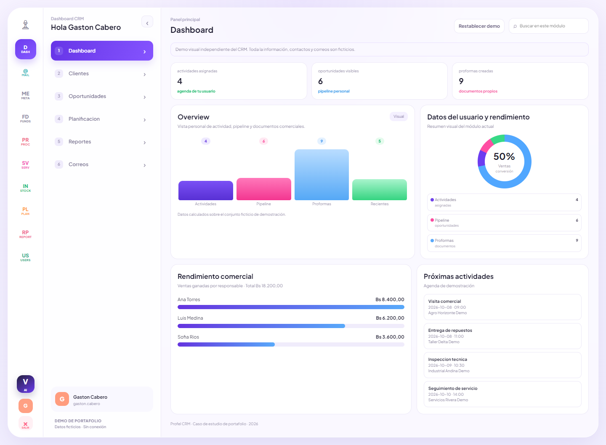
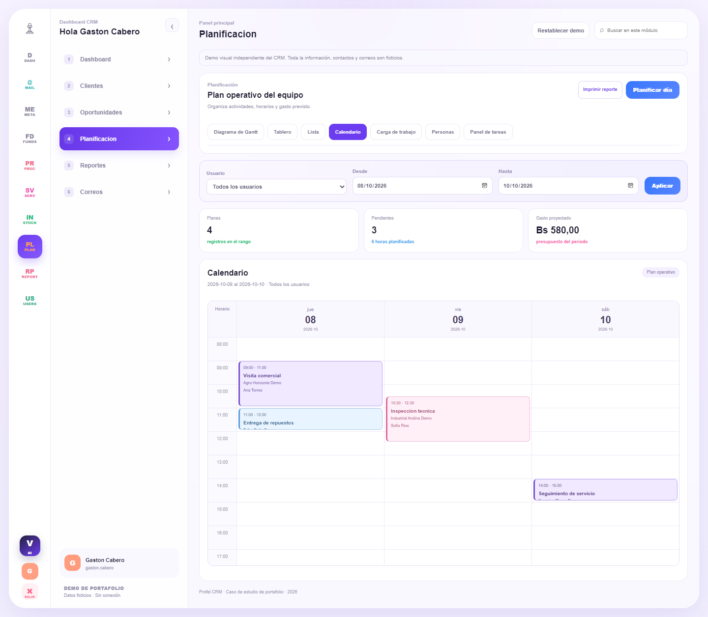
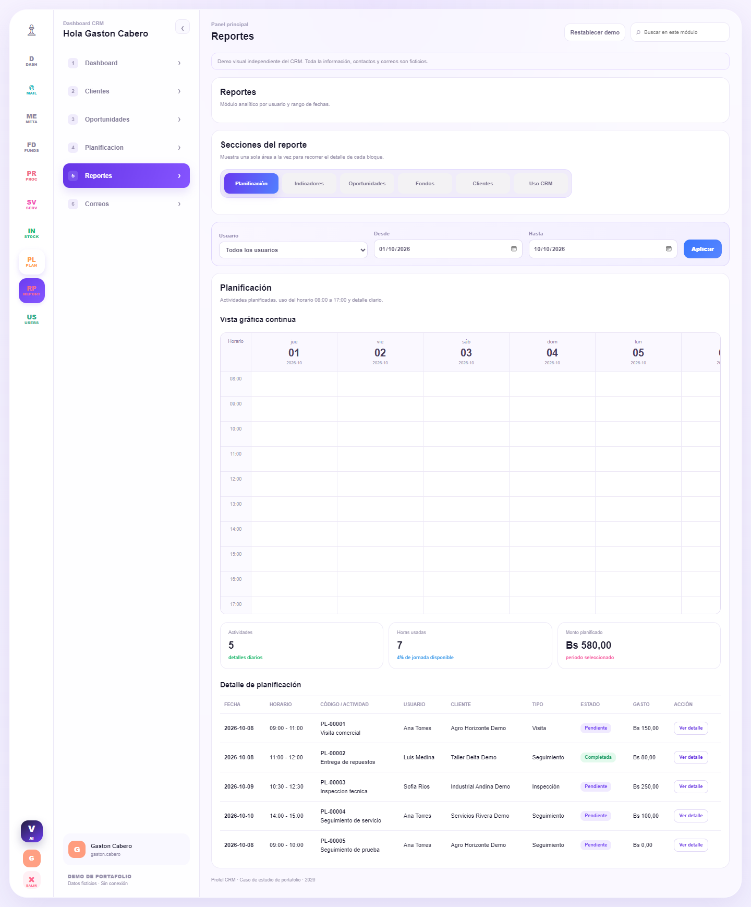

# CRM Comercial | Portafolio de Gaston Cabero

Demo interactiva de un sistema CRM para organizar clientes, oportunidades, planificaciones, documentos comerciales y reportes.

**Este repositorio contiene una demostracion visual independiente con datos ficticios. El codigo del sistema de produccion es privado.**



## Abrir la demo

Abre `index.html` en un navegador moderno. No necesita instalar paquetes, iniciar sesion ni conectarse a una base de datos. Los archivos se sirven tambien en GitHub Pages.

## Que puedes probar

| Modulo | Funciones disponibles en esta demo |
| --- | --- |
| Dashboard | Indicadores y ranking de ventas calculados con datos de ejemplo |
| Clientes | Busqueda por cliente, contacto y correo; filtro por zona |
| Oportunidades | Busqueda, filtro por responsable y fechas, detalle comercial |
| Planificacion | Calendario por horas, Gantt, tablero, lista, carga de trabajo, personas y tareas; crear actividades; filtros de usuario y fechas |
| Reportes | Planificacion, Indicadores, Oportunidades, Fondos, Clientes y Uso CRM; filtros de usuario y periodo, resúmenes desplegables y detalles |
| Correos | Busqueda por asunto, remitente y cuerpo; lectura de mensajes ficticios |

En los detalles de oportunidades puedes imprimir o guardar un documento de demostracion como PDF desde el navegador. No es el generador PDF del CRM de produccion.

Planificacion y Reportes siguen la estructura de las plantillas del CRM original. Incluyen horarios, presupuesto, indicadores y relaciones comerciales calculados con la muestra ficticia. Las actividades nuevas se conservan durante la sesion. La agenda grafica muestra hasta 31 dias y permite desplazamiento horizontal y vertical.




## El proyecto original

El CRM integra gestion comercial, agendas, planificaciones, proformas y ventas, rendicion de fondos y consulta de correos. Incluye permisos de acceso por usuario y seccion de Reportes, integraciones de datos y una aplicacion movil.

La plataforma original utiliza Python/Flask, PostgreSQL, consultas al archivo historico Firebird, JavaScript, HTML/CSS y despliegue con Docker. La demo publicada usa exclusivamente HTML, CSS y JavaScript.

**Contribucion:** desarrollo y evolucion funcional del CRM, interfaz de gestion, integracion de datos, documentos comerciales, permisos y despliegue. Esta descripcion presenta el alcance del proyecto sin publicar su implementacion privada.

## Publicar en GitHub

1. Crea un repositorio vacio, por ejemplo `crm-portafolio`.
2. Sube el contenido de esta carpeta al nivel principal del repositorio. No subas la carpeta del CRM original.
3. En **Settings > Pages**, selecciona **Deploy from a branch**, rama `main`, carpeta `/ (root)` y guarda.
4. GitHub mostrara la URL de la demo una vez terminado el despliegue.

Si prefieres Git desde esta carpeta:

```sh
git init
git add .
git commit -m "Publicar demo visual del CRM"
git branch -M main
git remote add origin https://github.com/TU_USUARIO/crm-portafolio.git
git push -u origin main
```

Reemplaza `TU_USUARIO` por tu usuario real. No se incluye una URL de repositorio inventada.

## Estructura

```text
index.html             Entrada de la demo
assets/app.js          Interacciones de portafolio
assets/styles.css      Diseno adaptable a escritorio y movil
data/demo-data.js      Datos ficticios compatibles con apertura local
docs/PROYECTO.md       Ficha del proyecto para presentar
LICENSE               Condiciones de uso
```

Los datos estan representados por objetos JavaScript serializables a JSON. Se cargan como script local para que la demo tambien funcione al abrir el archivo directamente, sin los bloqueos que algunos navegadores aplican a `fetch` de JSON en archivos locales.

## Limites y privacidad

Esta carpeta no contiene codigo del backend, exportaciones de bases de datos, credenciales, documentos originales, direcciones del servidor ni informacion de clientes reales. No envia correos y no escribe en el CRM. Los cambios de la demo solo duran hasta recargar la pagina.

No incluye autenticacion ni permisos reales: son funciones del sistema privado. No debe usarse como una aplicacion de produccion.

El codigo de esta demo sera visible si el repositorio es publico. La licencia reserva los derechos; no impide tecnicamente que alguien lo descargue. El backend original permanece fuera de esta carpeta.
